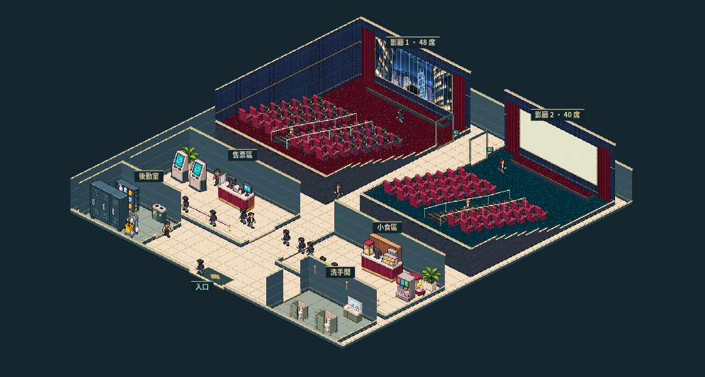

# 光影大亨 · Lumen Cinema

現代香港像素戲院經營遊戲。安排電影、票價同人手，觀察戲院自動營業；遇突發事件再決定親自救場，並用盈利升級、買斷物業及管理第二間分店。

[立即試玩 · GitHub Pages](https://jacobmaster-97.github.io/-lumen-cinema-repository/) · [遊戲框架](design/gdd.md) · [v0.3 重製說明](design/rebuild-v0.3.md) · [目前交接](CODEX_HANDOFF.md)



## v0.3 像素重製

- 無獨立候場區的分區影院：售票、小食、後勤、洗手間及兩個影廳。
- 8 排立體階梯座席，後排 +2.1 米、影廳淨高 5.2 米；起始 48 / 40 席。
- 新家具、材質、四方向客人／職員、20 款原創戲仿電影海報及實際放映畫面。
- 可拖曳、縮放、點選區域；客流沿家具、門口及樓梯可走路徑移動。
- 擴充座位與小食設備會同步反映在地圖；可選提示音、鍵盤及觸控操作。
- 原 v2 存檔繼續使用，保留現金、物業、兩店、排片及升級。

## 經營玩法

- 時間軸排片、電影片長及清潔緩衝、按場次定價。
- 六類客群、每週新片及逐步退熱；票房分帳與小食毛利分開呈現。
- 聘請、培訓、分配員工，系統自動排班及供貨。
- 正常速度一日 180 秒，可 2×／4× 加速，不能跳過事件。
- 售票、小食、清潔小遊戲可自行參與或交給員工；另有停映、謝票及維修事件。
- 裝修、音響、小食、座位、貸款、物業買斷及兩間分店直接管理。
- 每日收支報告、本機存檔與讀檔；所有分店共用日期與公司資金。

目前仍為可玩原型，經濟及日長待真人試玩調整。特別格式及完整影展屬後續內容。

## 本機啟動

遊戲沒有第三方瀏覽器執行依賴，需要 Node.js 24+ 作建置／測試，以及靜態 HTTP server。

```sh
git clone https://github.com/jacobmaster-97/-lumen-cinema-repository.git
cd -- -lumen-cinema-repository
npm ci --prefix prototypes/browser --ignore-scripts
npm test --prefix prototypes/browser
node scripts/build-pages.mjs
python3 -m http.server 8000 --directory dist/pages
```

開啟 `http://localhost:8000`。建置結果包含實際 PNG，不依賴開發用符號連結或外部 CDN。素材檢視器為 `/art.html`。所有素材載入後，可在斷網狀態繼續經營與本機存讀檔。

## 驗證

`npm test --prefix prototypes/browser`：27 項測試，包括財務／事件、DOM 整合、地圖、樓梯、升級容量、來源 PNG 及前版存檔相容。

真實 Chromium 流程使用：

```sh
python3 -m http.server 8192 --directory dist/pages
# 另開終端；需要環境提供 Playwright 及 Chromium
node scripts/verify-cinema-browser.cjs
```

本機完成 18 項瀏覽器流程檢查，包含三種小遊戲、日結、離線存讀檔及 390／720／1080 像素觸控尺寸。證據見 [瀏覽器紀錄](production/verification/v0.3/browser.json) 及 [重製說明](design/rebuild-v0.3.md)。DOM 測試與瀏覽器模擬尺寸不當作手機實機測試。

## 專案結構

| 路徑 | 內容 |
| --- | --- |
| `prototypes/browser/` | 遊戲狀態、介面、幾何導航、圖層及動態呈現 |
| `src/assets/cinema/runtime/` | v0.3 真正使用的 PNG、地圖、裁切及錨點 |
| `src/scenes/asset_preview.tscn` | 保留的 Godot 貼圖放置測試場景 |
| `tests/cinema/` | 模擬、介面、地圖與相容性驗證 |
| `production/verification/v0.3/` | 瀏覽器與發佈證據 |
| `.agents/skills/gamestudio/` | 使用者指定安裝的 gamestudio skill |

Godot 來源與九件舊 AtlasTexture 仍保留；可玩瀏覽器版實際使用 ES modules + Canvas 2D，技術邊界見 [ADR](design/architecture-browser-prototype.md)。

## 工作流程及來源

基於 [merlinhu1/codex-game-studio](https://github.com/merlinhu1/codex-game-studio)，保留 Git 歷史、[MIT 授權](LICENSE) 及 [原始 Studio 說明](STUDIO_README.md)。

本輪安裝並使用 [guangyuspace/codex-gamestudio-skill](https://github.com/guangyuspace/codex-gamestudio-skill)，版本與安裝範圍見 [INSTALLATION.json](.agents/skills/gamestudio/INSTALLATION.json)。上游 skill 的 LICENSE、NOTICE 與來源界線一併保留；未使用其示例遊戲素材或背景多代理 runtime。

新美術來源及提示見 [source-notes.md](src/assets/cinema/runtime/source-notes.md)。

## GitHub Pages 發佈

推送 main 後，既有 workflow 會先測試，再將 `dist/pages` 部署到現有網址。`version.json` 提供版本與建置 commit。回退可 revert 發佈 commit 並重跑同一 workflow，無需刪除玩家 v2 存檔。
